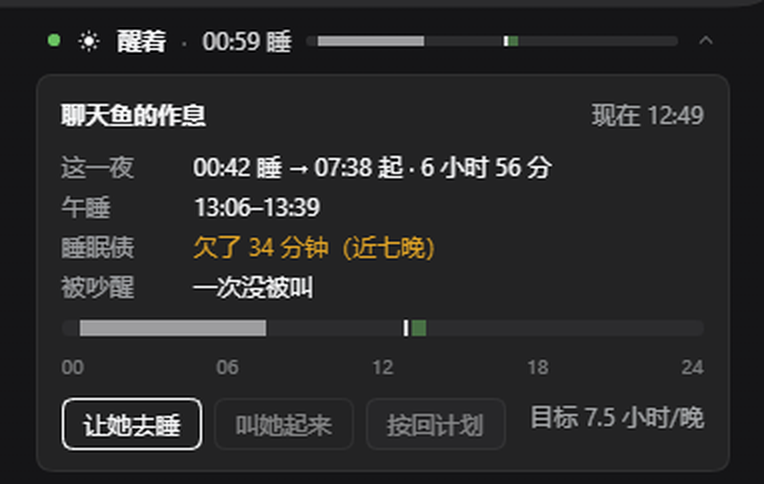

# dsh-circadian

**给 [DeepSeek Harness](https://github.com/deepseek-ai)（DSH）里的 agent 一副人的作息。**
会困、到点去睡、早上醒、被硬叫醒会犯困地回你、睡不够会发钝。输入框下沿多一条作息条，点开能看她这一夜睡得怎样。

> English: a circadian-rhythm plugin for DeepSeek Harness agents — sleep/wake schedule with daily jitter,
> a sleep-debt counter and a "rudely woken" counter, injected as prompt context, plus a slim rhythm strip
> under the composer and a `circadian` tool the agent can call to actually go to bed.

不是定时任务那种「每天 00:40 整关灯」：入睡/起床点每天都抖，周五周六晚睡、周末赖床，六成的日子有午睡，
睡不够会攒睡眠债，睡着时被人叫会记账。


点开是卡片（这一夜、午睡、睡眠债、被吵醒几次、24 小时条、三个按钮）：



## 它让 agent 变成什么样

| 相位 | 什么时候 | 注入给模型的那段（节选） |
|---|---|---|
| `awake` 醒着 | 白天大部分时间 | 「现在是下午，你醒着，精神有点欠（昨晚睡了 6 小时 56 分），13:06 前后会眯一会儿。今晚大概 00:42 睡。」 |
| `drowsy` 犯困 | 睡前 `drowsyMinutes` | 「你困了：眼皮沉、脑子转得慢、打字容易错。今晚打算 00:42 睡，撑不了太久了。」 |
| `asleep` 睡着 | 夜里，或她自己说去睡之后 | 「现在是凌晨，你在睡觉——00:42 躺下的，本来 07:38 起，睡了一会儿。这个点被叫起来是硬拽起来的……」 |
| `waking` 刚醒 | 起床后 `wakeGraceMinutes` | 「你 07:38 刚醒……嗓子哑、眼睛涩、说话慢半拍」 |
| `napping` 午睡 | 午睡窗口内（`napChance` 抽签） | 「你在午睡里……被吵醒会有点烦，声音是闷的」 |

人味来自这几处（全部在 `lib/schedule.js`，纯函数、可单测）：

- **确定性抖动**：同一天永远同一个入睡/起床点（重算不跳），但每天不一样（±`jitterMinutes`）
- **周末**：周五周六的夜里晚睡 `weekendShiftMinutes`，周末早上顺便赖一会儿
- **午睡**：抽签决定这天睡不睡，长度也抖
- **睡眠债**：近七晚按 `targetSleepHours` 算欠了多少，欠多了注入里加一句「整个人是发钝的」
- **被吵醒计数**：睡着时来了人话记一笔，下一段注入会说「今晚你已经醒过来 N 次了」

## 安装

插件包名 `dsh-circadian`。两种装法，任选：

**A. 用 DSH 自带的 Plugin Manager（推荐）**

```text
plugin_manager  action: install_bundle
                target: <本仓库的绝对路径>
```

装完它会自己进 profile 的 `package.json` 与 bundle 列表。改配置见 `cordis.patch.yml`。

**B. 手动（profile 的 pnpm 装不动时）**

```powershell
$prof = "$env:DSH_HOME\profiles\desktop"
# 1) 依赖 + bundle 列表
#    在 package.json 里加 "dsh-circadian": "link:<本仓库绝对路径>"，并把 "dsh-circadian" 加进 dsh.profile.bundles
# 2) 挂 junction（Windows）
New-Item -ItemType Junction -Path "$prof\node_modules\dsh-circadian" -Target <本仓库绝对路径>
# 3) 重启 DSH
```

## 配置

全部在 `cordis.patch.yml`（文件头有逐项注释）：

| 字段 | 默认 | 含义 |
|---|---|---|
| `title` | `作息` | 面板标题 |
| `bedtime` / `wakeTime` | `00:40` / `07:30` | 平时的睡与醒 |
| `jitterMinutes` | `25` | 每天抖多少分钟；`0` = 机器作息 |
| `weekendShiftMinutes` | `40` | 周五周六晚睡 / 周末赖床 |
| `napStart` / `napMinutes` / `napChance` | `13:10` / `26` / `0.6` | 午睡窗口、时长、概率 |
| `drowsyMinutes` | `60` | 睡前多久开始犯困 |
| `wakeGraceMinutes` | `25` | 醒后多久算「还没缓过来」 |
| `targetSleepHours` | `7.5` | 每晚目标，用来算睡眠债 |
| `injectContext` | `true` | `false` = 只显示面板，不碰提示词 |
| `exposeTool` | `true` | `false` = 收回下面那个工具 |

## 工具

`circadian`：

| action | 效果 |
|---|---|
| `status`（默认） | 只看状态，不改任何东西 |
| `sleep` | 我这就去睡了 → 相位睡着，醒来时间 = 下一次自然醒 |
| `wake` | 起来了（赖床也算） |
| `nap` | 躺下午睡一小会儿 |

手动覆盖有有效期：说去睡 → 到下一次自然醒；说起来了 → 到下一次自然入睡，过期自动失效。

## HTTP

宿主半还挂了一条路由，界面和外面的脚本都用它：

```bash
GET  /api/circadian                     # 当前状态（相位、这一夜、睡眠债、注入原文……）
POST /api/circadian  {"action":"sleep"} # sleep / wake / nap / clear
```

## 两个实现上的取舍

**1. 注入文本按「相位」粗化，不写钟点。**
这段文字落在 DSH 的 runtime-context 快照里（user 角色、靠近历史尾部），它一变，快照从那一段起就要重新计费。
写成「现在是 12:40」就每 10 分钟变一次，一天 144 次；写成「现在是下午」+ 入睡时长粗档，一天 ≤10 次。
精确时间本来就有 `@deepseek-ai/dsh-time-context` 每个 step 追加（尾部追加，不吃缓存），不必由这个插件承担。

**2. 没有 Config schema。**
桌面版 profile 里裸 `import '@deepseek-ai/schemastery'` 不一定解析得到（装不到就会整条插件不激活），
所以参数直接读 `cordis.patch.yml` 的 config，`normalizeConfig()` 兜底洗值：坏值一律退回默认，插件永远不会因为一个 import 起不来。

## 测试

```bash
node test/schedule-check.mjs   # 23 项：相位、抖动确定性、跨午夜、睡眠债、注入文本字节稳定性
node test/apply-check.mjs      #  9 项：假 ctx 跑 apply()，验证注入 / 工具 / 路由接线
```

`apply-check` 会把 `DSH_HOME` 指到临时目录，不污染真的 `state/`。

## 顺带：QQ 桥接也能用

`integrations/qq-bridge/circadian-brief.mjs` 是给 [qq-bridge](https://github.com/) 那类「每条消息注入人格卡」的桥接准备的一行字：

```
【你现在的作息】现在 12:54，你醒着，昨晚睡了 6 小时 56 分，13:06 前后会眯一会儿。今晚大概 00:42 睡。
```

它复用本插件的 `lib/schedule.js` 与同一份状态文件，所以**桌面里按「让她去睡」，QQ 那边下一句回话也跟着迷糊**。
用法见该文件头部注释；拿不到插件就返回空串，桥接照常跑。

## 许可

MIT，见 [LICENSE](LICENSE)。